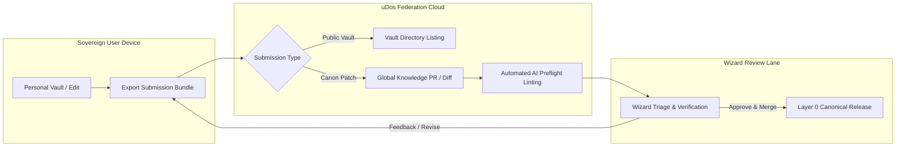

# Knowledge Layering, Wizard Maintenance & Cloud Federation Specification

## 1. Architectural Principles

In uDos, knowledge and datasets are sovereign, offline-first, and decentralized. To ensure systemic stability without restricting user autonomy, the ecosystem adopts a **three-tier cascading overlay architecture** paired with **external AI-assisted wizard curation**.

```
┌─────────────────────────────────────────────────────────────┐
│  Layer 2: Sovereign Personal Overrides (~/Vault/)           │  User Private
│  - Personal notes, clips, local edits, custom definitions   │  Full Precedence
├─────────────────────────────────────────────────────────────┤
│  Layer 1: Shared / Community Layer (~/Shared/)              │  Household & Peers
│  - Household vaults, shared team guides, peer datasets     │  Filter Overlay
├─────────────────────────────────────────────────────────────┤
│  Layer 0: Canonical Base Knowledge (~/Public/global-knowledge/)│ Read-Only Baseline
│  - Universal standards (USX, GridCore, Prose)               │ Curated by Wizard
│  - Standard datasets (Earth, celestial, units, metrics)     │ External AI Synthesis
└─────────────────────────────────────────────────────────────┘
```

---

## 2. Role Boundaries

### 2.1 The Wizard (System Architect & Maintainer)
- **Identity**: The system architect or advanced developer maintaining the core framework.
- **Authority**: Only the Wizard has direct write/merge authority over Layer 0 (`global-knowledge`, default datasets, and universal curriculum).
- **Tooling**: Development and curation occur strictly in external developer tooling (Antigravity IDE, `agy` CLI, Codex).
- **Frontier + Local AI Synthesis**: The Wizard employs automated Skills and Recipes executing on frontier models (Gemini 2.0 Flash/Pro, Claude 3.5 Sonnet, GPT-4o via OpenRouter) combined with local models (Ollama: Llama 3, Mistral, Qwen) to:
  - Normalize, validate, and index datasets (e.g. spatial coordinates, astronomical metrics).
  - Verify compliance against [`USX-STANDARDS.json`](standards/USX-STANDARDS.json) and [`GRIDCORE-STANDARDS.json`](standards/GRIDCORE-STANDARDS.json).
  - Clean and distill web-intake data before promoting it to canonical knowledge.

### 2.2 Sovereign Users
- **Experience**: Calm, serene desktop interaction within uCore surfaces (Local Wikipedia Reader, BrowserUI).
- **Protection**: Users cannot inadvertently overwrite, corrupt, or drift the canonical baseline.
- **Layering**: Users customize, extend, or correct knowledge by saving notes or dataset overlays into their personal `~/Vault` or `~/Shared` directories.

---

## 3. Resolution & Cascading Overlay Engine

When an article, dataset item, or definition is queried (via search, Local Wikipedia, or spatial APIs):

1. **Resolution Priority**:
   $$\text{Layer 2 (Personal Vault)} \succ \text{Layer 1 (Shared Vaults)} \succ \text{Layer 0 (Base Canon)}$$
2. **Non-Destructive Overlays**:
   - If an entry with an identical identifier (e.g. `EARTH-OC-L100-SYD`, `concept:time-dilation`, or `article:gardening`) exists in `~/Vault`, it is displayed with an `[Overlaid]` badge.
   - The user can toggle between viewing their personal overlay and the underlying canonical baseline.
   - Removing the personal override instantly restores the pristine canonical default.

---

## 4. Cloud Submission & Federation Lifecycle (Proprietary Cloud Roadmap)

When uDos introduces its sovereign cloud offering, community and user contributions flow through a decentralized, Wikipedia/GitHub-style submission and review pipeline:



### 4.1 Submission Package Format
A submission package consists of a cryptographic bundle:
- `manifest.json`: Metadata, author identity, target entity / topic ID, submission type (`vault_directory_listing` or `canonical_patch`).
- `diff.patch`: Git-compatible unified diff against the baseline canon.
- `provenance.json`: Source URLs, citations, offline provenance markers, and verification hashes.

### 4.2 Curation & Approval Workflow
1. **Intake & Automated AI Preflight**:
   - Cloud pipeline runs automated linting against USX and Prose standards.
   - Local/Frontier AI scans for privacy leaks, formatting errors, or broken internal links.
2. **Wizard Review**:
   - The Wizard inspects the proposed submission using the Document & Edition Review interface (`DeveloperReviewPanel` or PR review tool).
   - The Wizard triggers external verification recipes to validate mathematical/factual accuracy.
3. **Merge & Distribution**:
   - Approved patches are committed to the canonical `global-knowledge` repository.
   - Peer devices receive the updated canonical baseline through scheduled delta synchronization without compromising local user overlays.
