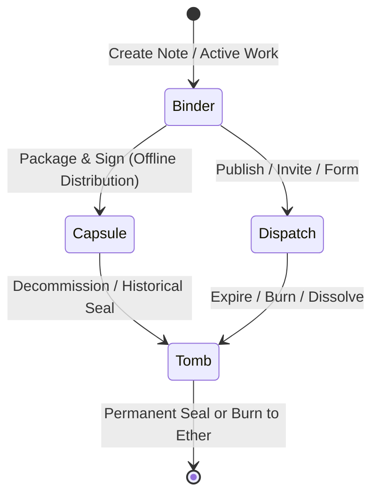

# uDos Universal Container Lifecycle & Storage Capacity Standards

This standard governs the four canonical container tiers in uDos (**Binder**, **Capsule**, **Publishing/Dispatch**, and **Tomb**), their lifecycle state transitions, ephemeral message dissolution policies, and knowledge storage capacity calculations across hardware targets.

---

## 1. The Four Universal Container Tiers

| Tier | Format / Signature | Mutability | Primary Purpose | Standard Storage Location |
| :--- | :--- | :--- | :--- | :--- |
| **1. Binder** | `.binder/` or `.udos_binder/` directory | Fully Mutable | Work-in-progress notes, clips, canvas sketches, and raw imports. | `~/Vault/binders/<id>/` |
| **2. Capsule** | `.capsule` bundle or `.zim` package | Immutable / Signed | Offline distribution bundle containing executable runtime, assets, and verified metadata. Consumed by Sonic Screwdriver for offline portals and uCode software libraries. | `~/Shared/capsules/` or USB storage |
| **3. Dispatch / Publishing** | `.dispatch.md` / Prose Email / `/p/:token` | Ephemeral / Public | Client-facing interactive projection (Prose email hero, Typeform-style card story, or permalink). Preserves source assets in `originals/`. | `~/Vault/dispatches/<id>/` |
| **4. Tomb** | `.tomb` archive record or dissolution tombstone | Read-only / Sealed | Archived historical witness, or tombstone state after an ephemeral dispatch has burned or expired. | `~/Vault/tombs/<id>/` |

---

## 2. Ephemeral Lifecycles & Dissolution Semantics

Dispatches support sovereign privacy through cryptographic tokens and decay policies:

- **`expires_at` (TTL)**: Timestamp after which the dispatch dissolves into a calm tombstone:
  > *"This dispatch was ephemeral and has dissolved into the ether."*
- **`burn_after_read` (Single-View / Single-Response)**: The server invalidates the token immediately upon completion of the interactive card flow or viewing.
- **Tombstone Transition**: When burned or expired, runtime access is terminated. If configured for historical retention, an immutable `.tomb` record is created; otherwise, the ephemeral keys are purged.

---

## 3. Storage & Vault Knowledge Capacity Engine

The capacity engine allows Sonic Screwdriver, CMMint, and uCore to calculate how many vault notes, capsules, and assets a target device can host.

### A. Mathematical Formulation
Given total storage device capacity $S_{\text{total}}$ and system reserved partition $S_{\text{sys}}$ (OS, kernel, base runtime packages):
$$S_{\text{vault}} = S_{\text{total}} - S_{\text{sys}}$$

- **Knowledge Density Metrics**:
  - Plain Markdown / Prose note: $\approx 3.5\text{ KB}$ ($3,500\text{ bytes}$)
  - SQLite FTS5 Search Index Overhead: $1.4\times$ text size ($\approx 4.9\text{ KB}$ total per indexed note)
  - Curated Animated BOB Asset (GIF): $\approx 25\text{ KB}$
  - Mini Capsule (Educational / Utility): $\approx 10\text{ MB}$
  - Offline Knowledge ZIM (Slice of Wikipedia / Docs): $\approx 1.0\text{ GB}$

### B. Hardware Target Capacity Matrix

| Target Hardware Profile | $S_{\text{total}}$ | $S_{\text{sys}}$ (OS + Runtime) | $S_{\text{vault}}$ (Usable) | Maximum Knowledge & Capsule Budget |
| :--- | :--- | :--- | :--- | :--- |
| **Sonic Live USB (Flash Drive)** | 4.0 GB | 2.5 GB (CMMint + uCore) | 1.5 GB | 1 ZIM Encyclopedia Capsule (1.0 GB) + $\approx 100,000$ indexed notes |
| **Recycled POS Terminal** | 16.0 GB | 3.5 GB (Linux + UI Hub) | 12.5 GB | 2 Large ZIM Capsules + $\approx 2,000,000$ transaction/menu notes |
| **Revived Classroom PC (SSD)** | 64.0 GB | 8.0 GB (Full OS + Runtimes) | 56.0 GB | 10 ZIM Capsules + uCode software library + full multi-year curriculum |
| **Sovereign Mac (Apple Silicon)** | 512.0 GB | 40.0 GB (macOS + Dev tools) | 472.0 GB | Comprehensive global canon, local LLM weights (Ollama), millions of notes |
